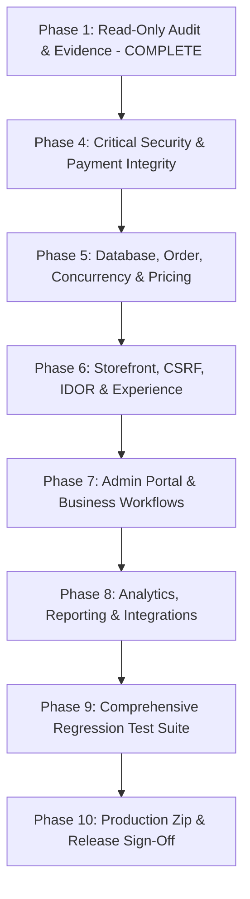

# AIWelkar Prioritized Repair Plan

**Project:** Welkar Watch E-Commerce Platform  
**Target:** Production Readiness & Defect Resolution  
**Date:** 2026-10-16  

---

## 1. Execution Sequence & Phase Mapping

According to the master operating sequence in [`AIWelkar.md`](file:///e:/welkar/AIWelkar.md), repairs are executed in controlled, prioritized phases:

---

## 2. Detailed Task Breakdown

### Phase 4: Critical Security & Payment Integrity (P0)

1. **Fix Payment Capture in Checkout (`SEC-001`)**:
   - File: [`app/Controllers/Storefront/CheckoutController.php`](file:///e:/welkar/app/Controllers/Storefront/CheckoutController.php)
   - Action: Remove `RazorpayAdapter::recordSuccess()` synthetic call upon order creation. Keep order in `pending_payment` status. Store order token in session for secure checkout completion.

2. **Fix Webhook Signature & Event Processor (`SEC-002`)**:
   - File: [`app/Services/Payments/RazorpayAdapter.php`](file:///e:/welkar/app/Services/Payments/RazorpayAdapter.php)
   - Action: Validate HMAC-SHA256 signature against raw webhook body using `Config::get('app.razorpay.webhook_secret')`. Update order and payment records upon `payment.captured` or `payment.failed` within a database transaction.

3. **Secure Customer Passwordless Account Flow (`SEC-003`)**:
   - File: [`app/Services/Auth/CustomerAuthService.php`](file:///e:/welkar/app/Services/Auth/CustomerAuthService.php)
   - Action: When an account exists without a password, reject direct password setting unless the customer has an active verified OTP challenge in session.

4. **Eliminate Debug OTP & MFA Code Leakage (`SEC-004`)**:
   - Files:
     - [`app/Services/Auth/CustomerAuthService.php`](file:///e:/welkar/app/Services/Auth/CustomerAuthService.php)
     - [`app/Services/Auth/AdminAuthService.php`](file:///e:/welkar/app/Services/Auth/AdminAuthService.php)
     - [`resources/views/auth/admin_mfa.php`](file:///e:/welkar/resources/views/auth/admin_mfa.php)
   - Action: Remove `debug_otp` and `debug_code` from public responses and session; remove the debug MFA code display box from `admin_mfa.php`.

---

### Phase 5 & 6: Database, Order Security & Storefront Protection (P1)

5. **Protect Order Confirmation from IDOR (`SEC-005`)**:
   - File: [`app/Controllers/Storefront/CheckoutController.php`](file:///e:/welkar/app/Controllers/Storefront/CheckoutController.php)
   - Action: Ensure only the authenticated owner or the session that created the order (via `placed_order_token`) can view `/order/success/{order_number}`. Return 404/403 for unauthorized lookups.

6. **Enforce CSRF on All State-Changing Routes (`SEC-006`)**:
   - File: [`config/routes.php`](file:///e:/welkar/config/routes.php)
   - Action: Add `[CsrfMiddleware::class]` to:
     - `POST /product/{slug}/review`
     - `POST /api/reviews/{id}/vote`
     - `POST /wishlist/toggle`

7. **Fix Analytics SQL Query Syntax & Group By (`DB-001`)**:
   - File: [`app/Services/Analytics/AnalyticsService.php`](file:///e:/welkar/app/Services/Analytics/AnalyticsService.php)
   - Action: Fix `o.{$whereClause}` string interpolation bug for `today` queries and ensure proper `GROUP BY` columns for `ONLY_FULL_GROUP_BY` compliance.

---

### Phase 7: Admin Portal & Missing Business Workflows (P2)

8. **Brand Management (Admin & Storefront)**:
   - Create: [`app/Controllers/Admin/BrandController.php`](file:///e:/welkar/app/Controllers/Admin/BrandController.php)
   - View: `resources/views/admin/brands/index.php`
   - Storefront Controller/Routes: `/brands`, `/brand/{slug}`
   - Action: Implement Brand list, add, edit, and toggle active status.

9. **Category Management Enhancements**:
   - File: [`app/Controllers/Admin/CategoryController.php`](file:///e:/welkar/app/Controllers/Admin/CategoryController.php)
   - Action: Add category update and safe delete check (preventing deletion if products reference the category).

10. **Homepage Banner & Section Management**:
    - Create: [`app/Controllers/Admin/BannerController.php`](file:///e:/welkar/app/Controllers/Admin/BannerController.php)
    - View: `resources/views/admin/banners/index.php`
    - Action: Allow admin to configure hero banners, image paths, headings, and CTA URLs.

11. **Admin Staff Roles & Security Governance**:
    - Create: [`app/Controllers/Admin/StaffController.php`](file:///e:/welkar/app/Controllers/Admin/StaffController.php)
    - Create: [`app/Controllers/Admin/AuditLogController.php`](file:///e:/welkar/app/Controllers/Admin/AuditLogController.php)
    - Views: `resources/views/admin/staff/index.php`, `resources/views/admin/audit_logs/index.php`
    - Action: Staff creation, role assignment, password resets, and change audit log viewer.

12. **Order Returns & Refunds Workflow**:
    - File: [`app/Controllers/Admin/OrderController.php`](file:///e:/welkar/app/Controllers/Admin/OrderController.php)
    - Action: Add actions to handle customer return requests, approve/reject returns, record refunds, and adjust inventory ledger.

13. **Abandoned Cart Tracking & Recovery**:
    - File: [`app/Controllers/Admin/MarketingController.php`](file:///e:/welkar/app/Controllers/Admin/MarketingController.php)
    - Action: Display abandoned carts with cart totals, items, and recovery link generation.

---

### Phase 8 & 9: Verification, Testing & Build (P0-P3)

14. **Automated Test Suite Expansion**:
    - File: [`tests/run_tests.php`](file:///e:/welkar/tests/run_tests.php)
    - Action: Expand test suite from 13 tests to cover payment security, order IDOR protection, CSRF verification, and analytics queries.

15. **Requirements Matrix & Test Report Generation**:
    - Create: [`AIWelkar-requirements-matrix.md`](file:///e:/welkar/AIWelkar-requirements-matrix.md)
    - Create: [`AIWelkar-test-report.md`](file:///e:/welkar/AIWelkar-test-report.md)

16. **Production Zip Packaging**:
    - Action: Rebuild [`welkar_production_website.zip`](file:///e:/welkar/welkar_production_website.zip) with all verified fixes, standard forward slashes, and clean staging.
